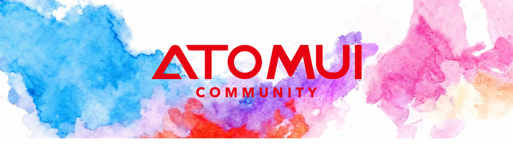

**Co-creating the UI foundation for AI-era software development.**

## Why we exist

Software is being rebuilt around AI. Agents write more of the code every day, and they — like
the people they build for — deserve foundations that are open, dependable, and owned by the
community that relies on them, not locked inside any single company.

UI is where that foundation meets the world. That is the layer
[AtomUI](https://github.com/AtomUI/AtomUI) serves: an open-source Ant Design 6 component system
for Avalonia/.NET desktop applications. This organization is where the ecosystem around it grows.

We hold three beliefs:

- **Infrastructure should be open.** The base layers of the AI era must be built in public and
  free to build upon.
- **Infrastructure should be proven.** It earns trust through real applications in production,
  not through promises.
- **Infrastructure should be shared.** Every project built here feeds its lessons back into the
  foundation, and every contributor shapes what comes next.

## What we do here

- **Build** — applications, tools and templates that run on AtomUI in the real world.
- **Showcase** — collect and highlight community projects that put the platform to the test.
- **Feed back** — turn real-world experience into issues, discussions and improvements in
  AtomUI itself.

## Projects

Five projects, one foundation: an AI coding client and the streaming text layer behind it, plus
native tools for the work developers do every day.

| Project | What it is |
| --- | --- |
| [TCode](https://github.com/AtomUICommunity/TCode) | A desktop client for AI coding agents — software for the AI era, built on our foundation. |
| [StreamMark](https://github.com/AtomUICommunity/StreamMark) | A native, streaming-first Markdown renderer for Avalonia — the text layer behind AI chat experiences. |
| [CxShell](https://github.com/AtomUICommunity/CxShell) | A cross-platform remote session client: terminals, file transfer, server monitoring and remote desktops in one workspace. |
| [RedisMe](https://github.com/AtomUICommunity/RedisMe) | A native Redis desktop client for browsing and editing data across standalone, Sentinel and Cluster deployments. |
| [AegisVault (玄钥)](https://github.com/AtomUICommunity/AegisVault) | A local-first, zero-knowledge password manager for Windows, macOS and Linux. |

## Build with us

Infrastructure is a team sport. Whether you're shipping a product, a tool, or an idea — if it
runs on AtomUI, it belongs here.

- ⭐ Star and watch [AtomUI/AtomUI](https://github.com/AtomUI/AtomUI)
- 🐛 Report bugs or request features in [Issues](https://github.com/AtomUI/AtomUI/issues)
- 🚀 Building something with AtomUI? Reach us through the
  [community channels](https://github.com/AtomUI/AtomUI#community) — we'd love to feature it.

